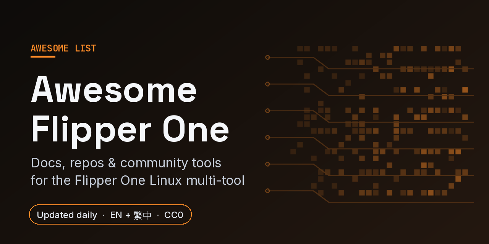

# Awesome Flipper One 

   

English | [繁體中文](README.zh-TW.md)

> Curated resources for [Flipper One](https://blog.flipper.net/flipper-one-we-need-your-help/) — Flipper Devices' open-source portable Linux multi-tool, currently in active community-driven development.

Flipper One is **not the same device as Flipper Zero**. Where Flipper Zero focuses on offline radio protocols (NFC, RFID, Sub-1 GHz), Flipper One is a network-layer tool built around a Rockchip RK3576 SoC, a Raspberry Pi RP2350 co-processor, a 256×144 monochrome LCD, dual Gigabit Ethernet, Wi-Fi 6E, and an M.2 slot. The hardware isn't shipping yet and the team has called for community contributions across seven sub-projects.

This list tracks what's currently public, what's being worked on, and where to plug in.

## New this week

Added between 2026-10-24 and 2026-10-30 (derived from git history).

- [uMTP-Responder fork](https://github.com/flipperdevices/uMTP-Responder) - Flipper's fork of the USB MTP responder daemon; its `flipper-devel` branch adds battery level, device-type and SuperSpeed descriptor changes, and `umtprd` is configured in the Flipper One build scripts and Flipper OS recovery image. _(Boot, kernel, and userspace)_
- [5G Modem app](https://docs.flipper.net/one/cpu-software/flipctl/5g-modem-app) - Requirements and plan for FlipCTL's cellular modem screen, which reads ModemManager over D-Bus; screenshots come from a prototype running a Quectel RM520N-GL. _(Flipper OS and FlipCTL)_
- [Dolphone](https://github.com/isaacrowntree/dolphone) - Unofficial calls and texts for a Flipper One with a cellular modem in the M.2 slot: FlipCTL dialer and messages apps on the panel, a desktop app, and a `phonectl` shell tool, with Bluetooth headsets and SIP calling. Hobby software, not for emergencies. _(Community tools)_
- [Flipper One Simulator](https://github.com/kai9987kai/FLIPPER-ONE-SIMULATOR) - Standalone offline browser simulator of the Flipper One concept with a clickable handheld and a 256×144 framebuffer; an independent educational project that does not run the official firmware or Linux. _(Community tools)_
- [Dev Log #11: Making Flipper One truly portable](https://docs.flipper.net/one/dev-log/11) (October 2026) - Power measurements: 0.96 W with Linux running and up to 24 hours on the 24 Wh battery, compared with a Raspberry Pi 5B. _(Articles and announcements)_

## Contents

- [At a glance](#at-a-glance)
- [Official resources](#official-resources)
- [Sub-projects](#sub-projects)
- [Hardware](#hardware)
- [Boot, kernel, and userspace](#boot-kernel-and-userspace)
- [Flipper OS and FlipCTL](#flipper-os-and-flipctl)
- [MCU firmware](#mcu-firmware)
- [Testing and developer tooling](#testing-and-developer-tooling)
- [Community tools](#community-tools)
- [Adjacent ecosystems](#adjacent-ecosystems)
- [Community](#community)
- [Articles and announcements](#articles-and-announcements)
- [Contributing to this list](#contributing-to-this-list)
- [License](#license)

## At a glance

How the entries split between official Flipper Devices sources, community projects, and third-party vendor references. Official means `flipper.net` sites, the `flipperdevices` GitHub org, and Flipper's own channels. Each link is counted once, in the first section where it appears.

| Section | Official | Community | Third-party reference |
|---|---:|---:|---:|
| [Official resources](#official-resources) | 7 | 0 | 0 |
| [Sub-projects](#sub-projects) | 7 | 0 | 0 |
| [Hardware](#hardware) | 9 | 0 | 2 |
| [Boot, kernel, and userspace](#boot-kernel-and-userspace) | 8 | 0 | 0 |
| [Flipper OS and FlipCTL](#flipper-os-and-flipctl) | 11 | 0 | 0 |
| [MCU firmware](#mcu-firmware) | 5 | 0 | 0 |
| [Testing and developer tooling](#testing-and-developer-tooling) | 0 | 0 | 1 |
| [Community tools](#community-tools) | 0 | 11 | 0 |
| [Adjacent ecosystems](#adjacent-ecosystems) | 3 | 1 | 0 |
| [Community](#community) | 3 | 0 | 0 |
| [Articles and announcements](#articles-and-announcements) | 3 | 0 | 0 |
| **Total** | **56** | **12** | **3** |

## Official resources

- [Developer portal](https://docs.flipper.net/one) - The canonical entry point. Start here.
- [Open tasks](https://docs.flipper.net/one/open-tasks) - Auto-generated from `help wanted` issues across all sub-project repos. Refreshed by CI in the docs repo.
- [Tech specs](https://docs.flipper.net/one/general/tech-specs) - RK3576, RP2350, MT7921AUN, M.2 Key-B (S3), display, battery, ports.
- [How to join](https://docs.flipper.net/one/how-to-join) - Recommended reading before opening your first PR.
- [Project organisation on GitHub](https://github.com/orgs/flipperdevices/projects) - Each sub-project has its own Kanban.
- [Dev Log](https://docs.flipper.net/one/dev-log) - Regular progress reports covering each sub-project. Entry #10 explains how to run Flipper OS on a supported RK3576 board before Flipper One ships.
- [Community projects page](https://docs.flipper.net/one/community) - Official index of community-built Flipper One projects, added via PRs to `flipperone-docs`.

## Sub-projects

Development is split across seven GitHub repositories. Each has its own Kanban, contribution guide, and `help wanted` queue.

| Area | Repo | Kanban |
|---|---|---|
| 🔌 Hardware | [flipperone-hardware](https://github.com/flipperdevices/flipperone-hardware) | [board #9](https://github.com/orgs/flipperdevices/projects/9) |
| ⚙️ Mechanics | [flipperone-mechanics](https://github.com/flipperdevices/flipperone-mechanics) | [board #15](https://github.com/orgs/flipperdevices/projects/15) |
| 🐧 Linux (CPU software) | [flipperone-linux-build-scripts](https://github.com/flipperdevices/flipperone-linux-build-scripts) | [board #11](https://github.com/orgs/flipperdevices/projects/11) |
| 🕹️ MCU firmware | [flipperone-mcu-firmware](https://github.com/flipperdevices/flipperone-mcu-firmware) | [board #8](https://github.com/orgs/flipperdevices/projects/8) |
| 🎨 User interface | [flipperone-ui](https://github.com/flipperdevices/flipperone-ui) | [board #12](https://github.com/orgs/flipperdevices/projects/12) |
| 🧪 Testing | [flipperone-testing](https://github.com/flipperdevices/flipperone-testing) | [board #14](https://github.com/orgs/flipperdevices/projects/14) |
| 📚 Docs | [flipperone-docs](https://github.com/flipperdevices/flipperone-docs) | [board #10](https://github.com/orgs/flipperdevices/projects/10) |

## Hardware

### Application processor

- [Rockchip RK3576 brief datasheet (PDF)](https://cdn.flipper.net/RK3576-Brief-Datasheet-V1.2-20240311.pdf) - Hosted by Flipper. Use this as the working reference until something more complete is published.
- [Collabora RK3576 mainline status](https://gitlab.collabora.com/hardware-enablement/rockchip-3588/notes-for-rockchip-3576/-/blob/main/mainline-status.md) - Tracks which RK3576 subsystems are mainlined upstream. The single most useful file for anyone working on the Linux side.

### Co-processor

- [RP2350 datasheet (Raspberry Pi)](https://datasheets.raspberrypi.com/rp2350/rp2350-datasheet.pdf) - Used for power management, display, buttons, touchpad, LEDs.

### Pinout and connectors

- [GPIO port docs](https://docs.flipper.net/one/hardware/gpio-port) - Pin-by-pin functions.
- [M.2 port docs](https://docs.flipper.net/one/hardware/m2-port) - Key-B (S3), USB 3.0 + PCIe 2.1 ×1, supports 30×52 and 30×42 modules.
- [M.2 modules](https://docs.flipper.net/one/hardware/m2-port/modules) - Categories of off-the-shelf M.2 modules that can extend Flipper One, with satellite modem and GNSS receiver subpages.
- [GPIO module examples](https://docs.flipper.net/one/hardware/gpio-port/modules) - Reference designs for community-built modules.

### Power and debugging

- [Power subsystem](https://docs.flipper.net/one/hardware/power-subsystem) - 2-cell Li-ion battery, USB PD charging on USB-C1, and DC/DC converters managed by the RP2350.
- [Debug Probe docs](https://docs.flipper.net/one/hardware/debug-probe) - RP2350-based probe that connects by ribbon cable to the debug port behind the back plate.
- [flipperone-debug-probe](https://github.com/flipperdevices/flipperone-debug-probe) - Firmware for the Debug Probe, with CI-built `.uf2` files for MCU and CPU debugging.

### Wireless

- MediaTek MT7921AUN - Wi-Fi 6E + Bluetooth combo. The team has noted they're still validating this choice and welcome alternative chip suggestions in the [help-wanted Wi-Fi testing thread](https://docs.flipper.net/one/hardware/wifi-bluetooth).

## Boot, kernel, and userspace

- [RK3576 boot flow](https://docs.flipper.net/one/hardware/rk3576/boot-flow) - On-chip ROM → RKNS → FIT → U-Boot → Linux. Flash offsets and what lives where.
- [RK3576 mainlining](https://docs.flipper.net/one/cpu-software/rk3576-mainlining) - Why Flipper One targets mainline-first instead of vendor BSP, and what that means for component support.
- [Flipper One Linux kernel fork](https://github.com/flipperdevices/flipper-linux-kernel) - Flipper-specific patches on top of mainline.
- [Flipper One U-Boot fork](https://github.com/flipperdevices/u-boot) - Tracks mainline U-Boot with Flipper-specific board support.
- [uMTP-Responder fork](https://github.com/flipperdevices/uMTP-Responder) - Flipper's fork of the USB MTP responder daemon; its `flipper-devel` branch adds battery level, device-type and SuperSpeed descriptor changes, and `umtprd` is configured in the Flipper One build scripts and Flipper OS recovery image.
- [How to build the Linux image](https://docs.flipper.net/one/cpu-software/how-to-build-linux-image)
- [How to install a Linux image](https://docs.flipper.net/one/cpu-software/how-to-install-linux-image) - Install Flipper OS to microSD or UFS with the on-device installer or by flashing manually.
- [Supported boards](https://docs.flipper.net/one/cpu-software/supported-boards) - RK3576 boards that run official Flipper OS images, with target names, boot priority, and MaskROM instructions.
- [Rockchip MaskROM mode](https://docs.flipper.net/one/cpu-software/maskrom-mode) - How the RK3576 picks a boot device and how to flash it over USB.

## Flipper OS and FlipCTL

- [Flipper OS docs](https://docs.flipper.net/one/cpu-software/flipper-os) - The concept behind Flipper OS: switchable OS profiles on top of Debian.
- [FlipCTL docs](https://docs.flipper.net/one/cpu-software/flipctl) - The UI framework that drives the device screen, web browser, and SSH control interfaces.
- [flipctl](https://github.com/flipperdevices/flipctl) - FlipCTL source: a backend that wraps systemd, networking, and CLI tools, plus an HTML/JS frontend.
- [flipctl-slint](https://github.com/flipperdevices/flipctl-slint) - Slint implementation of the Flipper One UI for the 256×144 SPI panel, shared by the installer and the boot menu.
- [flipctl-fonts](https://github.com/flipperdevices/flipctl-fonts) - Pixel fonts adapted for the FlipCTL UI.
- [flipctl-apps](https://github.com/flipperdevices/flipctl-apps) - Catalog (`apps.toml`) and release downloads for the apps a Flipper One can install from its app manager, such as test tools, a browser, and games.
- [5G Modem app](https://docs.flipper.net/one/cpu-software/flipctl/5g-modem-app) - Requirements and plan for FlipCTL's cellular modem screen, which reads ModemManager over D-Bus; screenshots come from a prototype running a Quectel RM520N-GL.
- [flipperos-installer](https://github.com/flipperdevices/flipperos-installer) - Rust installer that runs from an initramfs and installs Flipper OS on RK3576 boards, with TUI and on-screen GUI.
- [flipperos-installer-initramfs](https://github.com/flipperdevices/flipperos-installer-initramfs) - Buildroot recipe for the initramfs that runs the installer.
- [flipperos-boot-menu](https://github.com/flipperdevices/flipperos-boot-menu) - Buildroot initramfs that lists bootable profiles on the screen and kexecs into the chosen one.
- [flipperos-recovery](https://github.com/flipperdevices/flipperos-recovery) - Minimal immutable recovery initramfs that runs from RAM so it can reflash storage.
- [flipperos-btrfs-tools](https://github.com/flipperdevices/flipperos-btrfs-tools) - POSIX sh tools for btrfs-based OS profiles, snapshots, and BLS boot entries.

## MCU firmware

- [MCU firmware architecture](https://docs.flipper.net/one/mcu-firmware/architecture)
- [MCU ↔ CPU interconnect](https://docs.flipper.net/one/mcu-firmware/mcu-cpu-interconnect)
- [How to build firmware](https://docs.flipper.net/one/mcu-firmware/how-to-build-firmware) - Build the MCU `.uf2` from source and upload it over USB.
- [flipperone-mcu-protobuf](https://github.com/flipperdevices/flipperone-mcu-protobuf) - Protobuf description of the MCU RPC protocol, used as a submodule by the MCU firmware.
- [fbtng-corelibs](https://github.com/flipperdevices/fbtng-corelibs) - Core libraries included in the MCU firmware as `lib/corelibs`.

## Testing and developer tooling

- [flipperone-testing](https://github.com/flipperdevices/flipperone-testing) - Official test-bench scripts. The README is honest about the state: "Dirty vibe-coded tests scripts for Flipper One. To be completely rewrited." Useful entry points:
  - `fake-flipctl` / `fake-flipctl2` - In-browser device emulators (Node.js + websockets). Lets you develop and screenshot UI without real hardware.
  - `temperature/` - Continuous thermal monitoring with Plotly HTML reports. Works on any RK3576 SBC.
  - `cpu/sbc-bench.sh` - Bundled copy of [sbc-bench](https://github.com/ThomasKaiser/sbc-bench), the standard SBC benchmark tool.
- [Archbee starter](https://github.com/Archbee/starter) - Docs are built on Archbee. The official Flipper One developer portal is generated from `flipperone-docs` via Archbee's GitHub integration.

## Community tools

- [Flipper One Pinout](https://hypery11.github.io/flipper-one-pinout/) - Interactive viewer for the GPIO header and the M.2 port. Click a pin to see its functions and (on GPIO pins) the alternate-function mux configurations; filter by protocol (I²C, UART, SPI, SAI, PCIe, SIM, etc.). Source: [`hypery11/flipper-one-pinout`](https://github.com/hypery11/flipper-one-pinout). *(Disclosure: maintainer of this list.)*
- [Flipper One Lab](https://github.com/kalicyh/flipperone-lab) - Container images for running the public userspace and the `fake-flipctl2` UI harness in a desktop browser. Listed on the official community page.
- [QEMU Flipper OS](https://github.com/Gelules/qemu-flipperos) - Scripts that boot an official Flipper OS build in QEMU on a Linux PC, with FlipCTL in the browser.
- [Bad Apple!! on Flipper One](https://github.com/Gelules/flipperone-bad-apple) - Two Python FlipCTL apps that play Bad Apple!! on the 256×144 panel (greyscale and 1-bit), so far tested in QEMU.
- [Flipper One VM](https://github.com/plusmalias/flipper-one-vm) - Runs the official Flipper OS image on an Intel Mac under QEMU, with a live front-panel UI and SSH.
- [Flipper One Mac Demo](https://github.com/Nirbhik-Acharya-official/flipper-one-mac-demo) - Unofficial Apple Silicon app that boots Flipper OS in a local VM and shows FlipCTL in a macOS window.
- [flipper-profile](https://github.com/NetVar1337/flipper-profile) - btrfs + overlayfs OS profile manager, built as a working version of an RFC in `flipperone-linux-build-scripts`.
- [flipper-os-lab](https://github.com/xbizzybone/flipper-os-lab) - Local proof of concept for the Flipper OS storage architecture RFC (squashfs + dm-verity and an all-Btrfs alternative).
- [RK3576 Open LPDDR4X DDR Trainer](https://github.com/kendun555-svg/ddr-trainer) - Community attempt at an open DDR trainer to replace the closed RK3576 DDR blob in the boot chain.
- [Dolphone](https://github.com/isaacrowntree/dolphone) - Unofficial calls and texts for a Flipper One with a cellular modem in the M.2 slot: FlipCTL dialer and messages apps on the panel, a desktop app, and a `phonectl` shell tool, with Bluetooth headsets and SIP calling. Hobby software, not for emergencies.
- [Flipper One Simulator](https://github.com/kai9987kai/FLIPPER-ONE-SIMULATOR) - Standalone offline browser simulator of the Flipper One concept with a clickable handheld and a 256×144 framebuffer; an independent educational project that does not run the official firmware or Linux.

## Adjacent ecosystems

The following aren't Flipper One specifically but are part of the wider Flipper Devices ecosystem and worth knowing about.

- [awesome-flipperzero](https://github.com/djsime1/awesome-flipperzero) - Sister list for Flipper Zero.
- [Flipper Zero firmware](https://github.com/flipperdevices/flipperzero-firmware) - The other Flipper. Shares the `fbt` build tooling that Flipper One inherits parts of.
- [Flipper Zero µFBT](https://github.com/flipperdevices/flipperzero-ufbt) - The micro-fbt CLI. Conceptually a sibling to whatever build tool Flipper One eventually settles on.
- [qFlipper](https://github.com/flipperdevices/qFlipper) - Desktop companion app for Flipper Zero. The Flipper One companion app, when it exists, is likely to share patterns.

## Community

- [Flipper Devices Discord](https://discord.com/invite/flipper) - The `#flipper-one` channel is where most live discussion happens.
- [@Flipper_RND on X](https://x.com/Flipper_RND) - R&D account; this is where Flipper One progress gets announced.
- [Flipper Devices blog](https://blog.flipper.net/) - Long-form posts. Casper-themed: [Casper-flipper-blog-theme](https://github.com/flipperdevices/Casper-flipper-blog-theme).

## Articles and announcements

- [Dev Log #11: Making Flipper One truly portable](https://docs.flipper.net/one/dev-log/11) (October 2026) - Power measurements: 0.96 W with Linux running and up to 24 hours on the 24 Wh battery, compared with a Raspberry Pi 5B.
- [Flipper OS — the operating system for Flipper One](https://blog.flipper.net/flipper-os-the-operating-system-for-flipper-one/) (August 2026) - Flipper OS as a layer on top of Debian that switches between preconfigured system profiles.
- [FlipCTL — Our GUI Framework for Embedded Linux Systems](https://blog.flipper.net/flipctl-our-gui-framework-for-embedded-linux-systems/) (June 2026) - Why Flipper One needs a built-in UI and how FlipCTL works.
- [Flipper One. We need your help](https://blog.flipper.net/flipper-one-we-need-your-help/) (May 2026) - The call for community contribution that effectively launched the public development phase. Worth reading in full if you want to understand what the team is asking for.

(Open a PR to add more as they're published.)

## Contributing to this list

This list is intentionally honest about gaps. If a section is short, that usually means there genuinely isn't a lot of public material yet — not that the section is "coming soon".

To add a resource:

1. Open a PR with the addition in the most appropriate section.
2. Format: `- [Name](URL) - One-line description.` (one sentence, period at the end).
3. Keep it about Flipper **One** specifically. Resources that are equally about Flipper Zero belong in [awesome-flipperzero](https://github.com/djsime1/awesome-flipperzero).
4. Prefer primary sources (official docs, vendor datasheets, repos) over secondary write-ups.

See [CONTRIBUTING.md](CONTRIBUTING.md) for the full rules, or [suggest a project](https://github.com/hypery11/awesome-flipper-one/issues/new?template=suggest-project.yml) with the issue form.

## License

To the extent possible under law, the contributors to this list have waived all copyright and related or neighbouring rights to this work.
